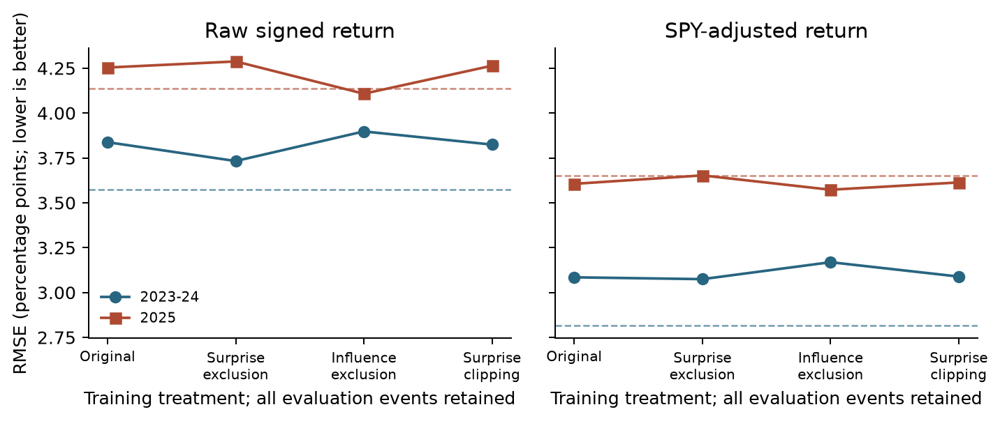

Post Earnings Stock Return Analysis

**Milestone 2 Data and Exploratory Analysis**
Georgia Tech ISYE 4031 Fall 2026 Group 9
Bill Nguyen, Sarah Wang, Cindy Le, Phoenix Moore, Victor Wang

**Preliminary answer.** Available earnings and price information does not yet produce reliable improvements over a constant training-mean forecast. Training-only outlier treatments change the results, but none consistently improves both later periods.

## 1 Research question and Meeting 1 response

After the initial earnings reaction, can earnings, price, volume, momentum and volatility information predict the direction and magnitude of the next five-session stock return? We retain signed gains and losses. Investors are the intended users, with buy, hold, sell or avoid decisions as the potential application. Our comparison asks whether regression reduces later-period MAE and RMSE relative to simple forecasts.

Meeting 1 notes supplied October 27 [1] prioritize longer histories per company, large-surprise and influence checks, outlier sensitivity, and explaining what makes the data informative. We implemented those checks and audited a suggested Kaggle source. The primary sample remains 400 validated events; longer history and additional companies are expansion work rather than completed observations. The question is distinctive because it predicts returns after the initial reaction, rather than including that jump in the target.

## 2 Data and preparation

Each row is one company-quarter earnings event. Cached Alpha Vantage EARNINGS records provide dates, reported/estimated EPS and surprise [3]. Yahoo Finance through yfinance provides daily prices and volume [4]. The ten symbols are AAPL, AMZN, GOOGL, JNJ, JPM, META, MSFT, NVDA, WMT and XOM. Each contributes 40 events reported January 14, 2016-November 20, 2025. SPY is the market benchmark. This October 27 rebuild reused existing primary caches; original retrieval timestamps were not recorded, so SHA-256 hashes identify the snapshot.

| Pipeline stage | Observations and treatment |
| --- | --- |
| Parse cached earnings dates and numbers | 1,105 records; no exact duplicates or invalid reported dates |
| Restrict reported dates to 2016-2025 | 400 events; 705 outside the window |
| Match first stock session strictly after report date | 400 matched; reject gaps over seven calendar days |
| Calculate features and require valid stock and SPY targets | 400 complete cases; zero missingness exclusions |

We predict at the close of the first stock trading day strictly after the reported earnings date, called reaction day i. The raw target is P[i+5]/P[i]-1, covering sessions i+1 through i+5. The secondary target subtracts SPY's return over the same dates. The initial jump is excluded. All series have adjusted closes; price caches contain 2,576 sessions per symbol from November 2, 2015-January 30, 2026. Returns are stored as decimals and displayed as percentages; financial values are not imputed.

<!-- page break -->

## 2 Data quality and prediction time availability

All required predictors and targets are nonmissing across the 400 events. There are no duplicate event keys, nonfinite modeling values or invalid timing rows. Cached prices have no duplicate/invalid dates, missing close/adjusted-close/volume values, nonpositive closes or negative volumes. Independent reconstruction of every event's dates, features and targets agrees within 10^-12. These checks establish internal consistency, not vendor accuracy or historical availability.

The model's 10 predictors are current/prior-quarter surprise (%), reported/estimated EPS (USD/share), reaction-day return, prior 5- and 20-session stock returns, prior 20-return sample volatility, prior 5-session SPY return (decimal returns), and abnormal volume (reaction volume divided by prior 20-session mean). Historical windows end before reaction day. Dollar EPS surprise remains in the data but is omitted from OLS because it exactly equals reported minus estimated EPS. No future return enters the predictors.

## 3 Exploratory findings

There are 223 positive returns (55.75%), 177 negative returns and no zeros. Mean return is +0.242%, median +0.319%, and standard deviation 4.085 percentage points (pp). Returns range from -22.196% to +13.496%. The large spread relative to the mean makes tail errors and a naive comparison important.

Surprise has little linear association with subsequent return (r = 0.045). Reaction-day return has a modest positive association (r = 0.187), consistent with some continuation but substantial scatter. Seven events have absolute surprise above 100%; five are AMZN events. XOM's 960% surprise accompanies estimated EPS of $0.05. Small denominators can create extreme percentages. We retain these genuine source values in the primary analysis and test their influence separately.

<!-- page break -->

## 4 Baseline results and outlier sensitivity

OLS with an intercept predicts signed return from the 10 predictors. StandardScaler fits on 2016-2022 training events only (n = 280). The fixed model is evaluated on 2023-2024 (n = 80) and the already inspected 2025 exploratory test (n = 40). Labels crossing split boundaries are excluded; none require purging here. No validation refit or tuning is used. References predict the original training mean (raw +0.154%, adjusted -0.213%) or zero every time. MAE measures average absolute error; RMSE gives larger errors more weight. Both are reported in pp.

| Period | Model | n | Raw MAE / RMSE (pp) | SPY adjusted MAE / RMSE (pp) |
| --- | --- | --- | --- | --- |
| 2023-24 | OLS | 80 | 2.906 / 3.838 | 2.381 / 3.085 |
| 2023-24 | Training mean | 80 | 2.662 / 3.572 | 2.099 / 2.818 |
| 2025 | OLS | 40 | 3.316 / 4.253 | 2.876 / 3.606 |
| 2025 | Training mean | 40 | 3.161 / 4.135 | 2.974 / 3.651 |

Table 1. OLS does not beat the mean consistently. Raw-return RMSE is worse in both periods; adjusted-return OLS is worse in validation and only slightly better in 2025. Raw direction accuracy is 57.5%/55.0%, versus 57.5%/60.0% for always predicting positive. Zero-forecast results and R-squared are in baseline_metrics.csv.

| Raw return training treatment | Removed | Validation RMSE (pp) | 2025 RMSE (pp) |
| --- | --- | --- | --- |
| Original OLS | 0 | 3.838 | 4.253 |
| Exclude surprise over 100% | 7 | 3.733 | 4.288 |
| Exclude influential training events | 17 | 3.898 | 4.108 |
| Clip surprise to training 1st/99th percentiles | 0 | 3.824 | 4.264 |

Table 2. All 80 validation and 40 test events are retained in every treatment. Surprise exclusion removes training rows with absolute current surprise above 100%. Influence exclusion uses original training Cook's distance above 4/n. Clipping uses training 1st/99th percentiles of current and prior surprise; it never clips outcomes. Each variant refits scaling and OLS using its training data only.

Removing seven large-surprise training events helps raw validation error but worsens 2025. Removing 17 influential training events helps 2025 but worsens validation. Clipping has similarly mixed effects, so the original all-event OLS remains primary. Raw errors exceed 5 pp in 16/80 validation and 9/40 test events. AMZN April 28, 2022 has the largest training Cook's distance (0.191); AAPL July 31, 2025 has a held-out error of 13.975 pp. Influence flags do not establish data errors.

<!-- page break -->

## 5 Preliminary answer limitations and next steps

The hypothesis of useful post-reaction prediction is not established. Weak associations and inconsistent reference improvements do not support a trading deployment or causal interpretation. We make no coefficient significance claim: 40 repeated events per company, 148 events sharing reaction dates, and 597 overlapping target-window pairs can create dependent errors. Year/company/volatility tables and leave-one-calendar-quarter-out checks describe instability; they are not independence-based significance tests.

Date-only announcements can misidentify the initial reaction for premarket releases. Retrospective EPS estimates and adjusted prices are not guaranteed point-in-time records. Current large-company selection omits failed/delisted firms and limits generalization. Predicting at the close also does not establish an executable trade at that close; spreads and costs remain untested.

The history audit finds 675 pre-2016 earnings records and 631 potential events in 2010-2025, including one with a missing earnings value. They are not yet validated modeling observations; older stock/SPY lookbacks and targets must be obtained first. The Kaggle candidate [5] has 168,603 earnings rows ending June 2021, with 57,256 missing EPS estimates and 60,203 missing release-time labels. It offers some pre/post-market labels but cannot supply 2023-2025 testing. Its price-file completeness and reuse terms need further review; it was not merged into the primary sample.

Milestone 3 should deepen history per company before broadening the universe, report coverage by company/year, and compare simple regularized or longitudinal/company-effect models using rolling chronological splits and purged labels. Earnings events are irregularly spaced. Investigate dependence-aware uncertainty, release timing, vendor revisions and realistic execution. Additional rows or outlier removal should not be used merely to obtain favorable significance.

## 6 Team responsibilities and reflection

The proposal describes prior contributions below; next-stage owners are proposed assignments. Confirm actual individual Milestone 2 work before submission.

| Member | Prior contribution | Proposed next stage |
| --- | --- | --- |
| Bill Nguyen | Analysis and exploratory plots | Year/company performance and rolling evaluation |
| Sarah Wang | Cleaning and analysis with Cindy | Outlier review and sensitivity tables |
| Cindy Le | Data preparation and analysis with Sarah | Older history and release-time audit |
| Phoenix Moore | Proposal writing and initial cleaning | Interpretation and dataset-expansion review |
| Victor Wang | Target refinement and GitHub coordination | Reproducibility and evaluation implementation |

**Reflection.** A complete dataset did not ensure informative predictions. The naive comparison exposed weak forecasting performance; outlier checks showed that deleting difficult training events did not consistently solve it. The TA's emphasis on data history and quality led to concrete coverage and sensitivity audits rather than a claim of significance. The original signed target and full held-out samples remain intact.

**AI assistance disclosure.** OpenAI Codex assisted with implementation, analysis, writing and packaging. The group must review and understand the methods, verify individual contributions and follow syllabus disclosure requirements.

**Reproducibility and references.** Run run_pipeline.py, then run_milestone2.py. Optional audit_kaggle.py --download reproduces the separate candidate audit. See MILESTONE2_README.md for exact versions, paths and source hashes.
[1] Meeting 1 notes supplied by the group October 27, 2026; reports/MEETING1_FEEDBACK.md.
[2] ISYE4031_Milestone2_Students.pdf, Fall 2026 course brief.
[3] Alpha Vantage EARNINGS: alphavantage.co/documentation/#earnings.
[4] yfinance PriceHistory: ranaroussi.github.io/yfinance/reference/yfinance.price_history.html.
[5] tsaustin, US historical stock prices with earnings data, Kaggle version 7; kaggle.com/datasets/tsaustin/us-historical-stock-prices-with-earnings-data. Candidate summary and earnings files audited October 27, 2026.
