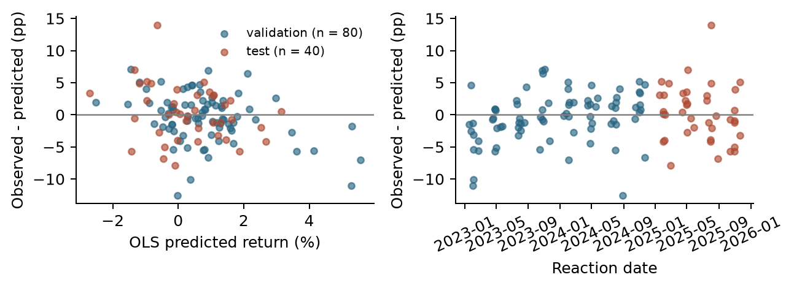

Predicting returns after earnings

**Milestone 2: Data and Exploratory Analysis**
Georgia Tech ISYE 4031, Fall 2026 - Group 9
Bill Nguyen, Sarah Wang, Cindy Le, Phoenix Moore, Victor Wang

**Preliminary answer.** The current linear model does not reliably improve on a training-mean forecast. Weak exploratory associations do not yet support using these predictions for trading decisions.

## 1 Research question

After the initial market reaction to a quarterly earnings announcement, can earnings, price, volume, momentum and volatility information predict the **signed stock return over the next five trading sessions**? The intended users are investors considering whether to buy, hold, sell or avoid a stock after earnings. Our testable comparison is whether a multiple linear regression reduces later-period MAE and RMSE relative to a constant training-mean prediction.

We retain all signed outcomes and predict at reaction-day close. The target covers the following five trading sessions, so the initial reaction-day jump is not part of the response. This analysis uses the existing 400-event pilot; an approximately 100-stock expansion remains a possible later step. All results below come from the existing cached dataset and analysis, rather than a new data retrieval on October 21.

## 2. Data and preparation

One observation is a company-quarter earnings event. Existing downloaded Alpha Vantage EARNINGS JSON supplies reported dates, EPS estimates/results and surprise [3]. Yahoo Finance prices through yfinance supply daily prices and volume [4]. This run reused those caches, with no new retrieval or paid access. Exact original retrieval timestamps were not recorded; file hashes identify the snapshot. Earnings dates span January 14, 2016-November 20, 2025. The selected symbols are AAPL, AMZN, GOOGL, JNJ, JPM, META, MSFT, NVDA, WMT and XOM; each contributes 40 events. SPY is the benchmark.

| Pipeline stage | Records / treatment |
| --- | --- |
| Cached earnings -> parse dates/numbers | 1,105 records; zero exact duplicates or invalid reported dates |
| Restrict reported dates to 2016-2025 | 400 events; 705 records outside this window |
| Match to strictly later stock session | 400 matched; reject any match more than 7 calendar days later |
| Construct features and valid stock/SPY targets | 400 complete cases; zero exclusions for missingness |

Prices cover November 2, 2015-January 30, 2026: 2,576 sessions for each stock and SPY. All series have adjusted closes. With reaction index i, the primary target is P[i+5]/P[i]-1; the secondary target subtracts SPY's return over the same dates. The reaction-day jump is excluded from both. Returns are stored as signed decimals and displayed as percentages. No financial values are imputed, and extreme observations are retained.

<!-- page break -->

## 2. Data quality and prediction-time availability (continued)

The all-events table has zero missing values in all 11 candidate predictors and both return targets; the modeling table has zero duplicate event keys, nonfinite values or invalid event-date orderings. Cached prices have zero duplicate/invalid dates, missing close/adjusted-close/volume values, nonpositive closes or negative volumes. These checks establish internal consistency, not vendor accuracy or historical completeness.

Predictors available through reaction-day close are reported/estimated EPS (USD/share), current/prior-quarter surprise (%), reaction-day return, prior 5- and 20-session stock returns, prior 20-return sample volatility, prior 5-session SPY return (decimal returns), and reaction volume divided by prior 20-session mean volume (ratio). Historical return/volume windows end before reaction day. Dollar EPS surprise remains in the data but is omitted from the regression because it exactly equals reported minus estimated EPS. All 400 events' dates, features and targets were independently reconstructed from the caches; maximum numeric difference was below 10^-12.

## 3. Exploratory findings

Figure 1. Full signed-return distribution. The vertical line marks zero; all 400 events are retained.

Positive returns occur in 223 events (55.75%); 177 are negative and none are zero. Mean return is +0.242%, median +0.319%, and standard deviation 4.085 percentage points (pp). The range is -22.196% to +13.496%. Variation greatly exceeds the mean, so small positive forecasts offer little protection against large losses.

Figure 2. Full-sample predictor relationships; descriptive fitted lines use all 400 events. These lines are not holdout models.

Surprise has little linear association with future return (r = 0.045); reaction-day return has a modest positive association (r = 0.187), consistent with some continuation but substantial scatter. Seven events have absolute surprise above 100%; XOM's 960% surprise on May 1, 2020 accompanies estimated EPS of $0.05. These are verified source values, retained without winsorization. Small denominators can create large surprise percentages, so influence needs inspection.

<!-- page break -->

## 4. Baseline and initial results

We fit ordinary least squares with an intercept and the 10 nonredundant predictors [5]. StandardScaler is fitted only on training observations. The primary response is raw signed return, matching the proposal's decision; SPY-adjusted return is a separate secondary analysis. Future SPY returns are used only to define that response, never as a predictor. No hyperparameter search or outcome-based outlier deletion is performed.

The fixed model and training-mean reference use 2016-2022 (n = 280). Validation uses 2023-2024 (n = 80); 2025 is a later exploratory test (n = 40). Splits use reaction dates and exclude earlier-period events whose target ends across the next boundary; this snapshot requires zero purges. Models are not refitted on validation before the 2025 evaluation. Because 2025 has now been inspected, Milestone 3 must not treat it as a fresh untouched test.

| Target / period | Model | n | MAE (pp) | RMSE (pp) | R-squared |
| --- | --- | --- | --- | --- | --- |
| Raw / 2023-24 | OLS | 80 | 2.906 | 3.838 | -0.160 |
| Raw / 2023-24 | Training mean | 80 | 2.662 | 3.572 | -0.005 |
| Raw / 2025 | OLS | 40 | 3.316 | 4.253 | -0.068 |
| Raw / 2025 | Training mean | 40 | 3.161 | 4.135 | -0.009 |
| SPY-adjusted / 2023-24 | OLS | 80 | 2.381 | 3.085 | -0.199 |
| SPY-adjusted / 2023-24 | Training mean | 80 | 2.099 | 2.818 | -0.001 |
| SPY-adjusted / 2025 | OLS | 40 | 2.876 | 3.606 | 0.018 |
| SPY-adjusted / 2025 | Training mean | 40 | 2.974 | 3.651 | -0.007 |

Table 1. Errors are percentage points of five-session return; lower is better. MAE averages absolute errors, RMSE emphasizes large errors, and negative R-squared indicates worse squared error than the evaluation-period mean. The actionable reference is estimated from training only.

Raw-return OLS raises RMSE by 7.43% in validation and 2.87% in 2025 relative to the training mean. Direction accuracy is 57.5% and 55.0%, versus 57.5% and 60.0% for always predicting a positive return. SPY-adjusted OLS raises validation RMSE by 9.47% and lowers 2025 RMSE by only 1.24%; this isolated improvement is not reliable evidence of skill. Zero forecasts give raw-return RMSE of 3.586/4.152 pp and SPY-adjusted RMSE of 2.832/3.639 pp, also showing the need for a naive comparison.

Figure 3. Held-out raw-return residuals versus prediction and time. Large errors remain; independence and constant variance are not established.

Training design rank is 11 of 11; removing redundant EPS surprise restores full rank. Cook's distance exceeds the 4/n screening threshold for 17 training events; the largest is AMZN, April 28, 2022 (D = 0.191). These flags do not justify automatic deletion. In held-out data, AAPL's July 31, 2025 event returns +13.326% versus -0.649% predicted, an error of +13.975 pp. Large residuals and weak forecasts motivate robustness checks rather than causal coefficient claims.

<!-- page break -->

## 5. Preliminary answer, limitations and next steps

The pilot supports a modest descriptive association between the initial price reaction and later signed return, but the multivariable baseline does not consistently beat simple forecasts. The original hypothesis of useful post-reaction predictors is therefore **not established**. These observational associations do not show that earnings or price reactions cause subsequent returns, and forecasting accuracy alone would not establish deployment readiness.

**Dependence and selection.** Each company appears 40 times; 148 events share a reaction date, and 597 pairs have overlapping future windows across companies. There are 0 within-company overlapping target-window pairs. Common market shocks can correlate errors, so 400 rows do not mean 400 independent experiments. Ten currently active large companies omit failed/delisted firms and many industries. No missing observations in this pilot does not eliminate survivorship or selection bias.

**Timing and measurement.** Date-only earnings reports make the first-later-session convention imperfect for premarket releases. Retrospective EPS estimates/surprises and adjusted-price histories are not guaranteed to be the values available at the historical prediction time. Formula checks prevent mechanical future-price leakage but cannot prove point-in-time vendor availability. Predicting at the close also does not establish an executable trade at that exact close; later work needs a tradable entry time, spreads and costs.

**Milestone 3 priority.** Evaluate a small set of simple models with rolling chronological origins and label-window purging, fit every transformation within each training fold, and compare with training-mean and zero forecasts. Report performance by company/year and use dependence-aware uncertainty estimates. Check release timing and vendor revisions, then test influence sensitivity and regularization without deleting difficult events. Expand toward 100 stocks only with a documented historical selection rule and available free access. A trading application requires a prespecified entry/exit rule and evidence of benefit after costs.

## 6. Team contributions and reflection

Our project proposal [1] describes the prior contributions below. The proposed next-stage roles organize the work needed for the next analysis phase.

| Member | Documented prior contribution | Proposed next-stage ownership |
| --- | --- | --- |
| Bill Nguyen | Research question, analysis and plots | Rolling evaluation; year/company performance |
| Sarah Wang | Predictor research; cleaning/analysis with Cindy | Missingness, unusual values and feature audit |
| Cindy Le | Stock research; cleaning/analysis with Sarah | Release-time and point-in-time checks |
| Phoenix Moore | Application, proposal writing, initial cleaning | Limitations, decision rule and report writing |
| Victor Wang | Target refinement and GitHub collaboration | Reproducibility, baseline code and packaging |

**Reflection.** Defining signed targets and explicit event timing made the question testable. A complete dataset did not resolve dependence, sample selection or historical availability. The training-mean comparison showed that the regression did not consistently improve forecasting, and the exact EPS identity required removal of a redundant predictor. These findings support checking the evaluation design and data quality before adding model complexity.

**AI assistance disclosure.** OpenAI Codex assisted with code, diagnostics, report drafting and packaging. Results were computed from existing real-data caches. Team review and verification of the analysis and explanations remain necessary; disclosure must follow the course syllabus.

**Reproducibility and references.** Run run_pipeline.py, then run_milestone2.py; see MILESTONE2_README.md and pinned package versions. Editable Word version: reports/build_word_documents.py. Original numerical analysis: run_milestone2.py. Snapshot hashes and full diagnostics are in outputs/milestone2.
[1] Group 9, ISYE 4031 Project.pdf, supplied team notes and Milestone 1 proposal, pp. 1-3, 6-8.
[2] ISYE4031_Milestone2_Students.pdf, supplied course brief, Fall 2026.
[3] Alpha Vantage, EARNINGS documentation: alphavantage.co/documentation/#earnings.
[4] yfinance, PriceHistory documentation: ranaroussi.github.io/yfinance/reference/yfinance.price_history.html.
[5] scikit-learn, Ordinary Least Squares: scikit-learn.org/stable/modules/linear_model.html.
Online documentation checked October 11, 2026. Data are from the existing cached snapshot, not that access date.
