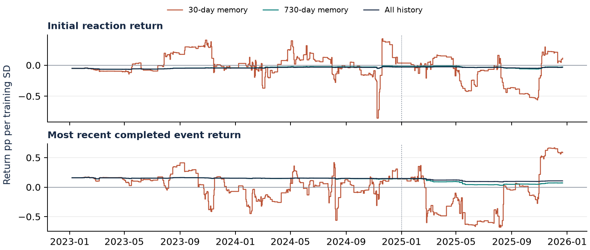
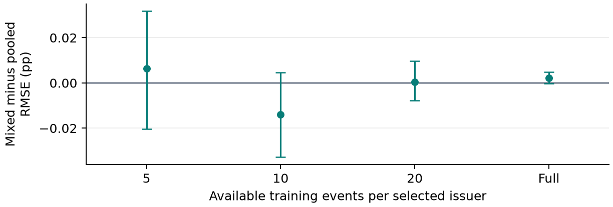

# Can online updates improve post-earnings forecasts?

**ISYE 4031 · Group 9 · Milestone 3 Check-in 2** 
Bill Nguyen, Sarah Wang, Cindy Le, Phoenix Moore, and Victor Wang

## 1. Question and motivation

Do five-session stock return forecasts improve if an earnings-event AR-X updates its coefficients as new outcomes become observable? The forecast is made at the close of the first trading session strictly after the reported earnings date. The target is the signed close-to-close return over the next five stock sessions. A better model would give an analyst a more useful estimate of the return remaining after the initial reaction.

Milestone 2's frozen AR-X had higher RMSE than the training mean in 2023–2024, then lower RMSE in the already-inspected 2025 period. Check-in 1 proposed a mixed-effects neural network to capture persistent issuer differences. The TA feedback led us to test a second explanation for the uneven results. A predictor's relationship with future return may change over time, so giving recent completed events more weight might help. This is plausible when a relationship changes persistently and harder when a few recent events are noisy. A separate test asks whether a recurring issuer-level bias is stable enough to forecast.

## 2. Method and experiment

**Common data and timing.** The parent snapshot has 28,496 events across 495 issuers. With the seven Milestone 2 predictors available, there are 28,368 events across 492 issuers. The initial fit uses 22,551 events through 2022. All primary models score the same 3,869 events in 2023–2024 and 1,947 in 2025, preserving both signs of return. One boundary event is unscored and enters the replay after maturing. The table's inputs are the most recent and fourth-most-recent completed issuer event returns, three completed calendar returns, EPS surprise, and initial reaction return. Standardization uses only initial-fit rows for each origin.

**Frozen comparators.** The training mean tests how well a single forecast performs. Frozen AR-X uses all seven predictors in one shared linear equation. Its forecasts reproduce Milestone 2 to within rounding. A small pooled neural network can capture nonlinear relationships, such as an initial price move mattering differently at large surprises. It uses eight tanh units, a linear output, and a fixed weight penalty. Added flexibility can fit sample-specific patterns. Mixed AR-X and the mixed neural network estimate an issuer intercept jointly with the shared function using the Gaussian marginal likelihood of a random-intercept model [2]. Both model issuer effects with mean zero and a common variance. An issuer’s adjustment equals its average training residual multiplied by nτ²/(σ² + nτ²), where n is its event count, τ² is issuer variance and σ² is residual variance. Small n or small τ² pulls the estimate toward zero. An unseen firm gets zero. A persistent difference in average return could benefit from this structure. A fixed issuer intercept can only shift that firm's average level.

**Why these controls matter.** Online AR-X allows one change in a coefficient to affect forecasts across companies. An issuer intercept estimates a stable level for one company. Holding the seven inputs, timing and forecast rows fixed makes these explanations testable. Annual refits of the static models check whether the conclusions depend on freezing a fit at the end of 2022.

<!-- pagebreak -->

## 2. Method and experiment (continued)

**How online updating works.** At each forecast close, first bring in return labels whose five-session windows ended on an earlier date. A label ending on the forecast date waits until a later forecast close. Make all forecasts for that date from the same coefficients. For example, the return from the December 2022 PAYX event finished on January 3, 2023. It entered the model before the first scored close on January 6.

Let **x** be the standardized inputs plus a column of ones, and let **y** be the completed return in percentage points. The model remembers a matrix of predictor products **S** and a vector of predictor–return products **r**, initialized with equal weights on the same data as frozen AR-X. At each batch of newly completed returns it updates S ← dS + XᵀX and r ← dr + Xᵀy, then solves Sβ = r. The decay d = 2^(−elapsed calendar days / half-life) determines how fast old information loses weight. No forgetting sets d = 1. A large error can produce a large update when its predictors have leverage. The update uses sufficient statistics for the constant forgetting idea in Goel, Bruce and Bernstein [1], with date-based batches and delays for earnings labels. A shorter half-life makes the forecast more sensitive to recent evidence and to recent noise.

**Tuning and uncertainty.** Using rolling forecast origins in 2017, 2019 and 2021 and scoring the following two years for each, 730 days was the best finite half-life among 30, 90, 180, 365 and 730. No forgetting scored better in all three folds. The 30-day run tests aggressive forgetting. The neural models use the same architecture in every comparison, with three fixed starting seeds to check sensitivity. Seed 17 is the reference fit used in the main table. The 2023–2024 window was used in earlier coursework and the 2025 window is exploratory because the team already inspected it. The earlier tuning windows keep the half-life selection out of these evaluation years. The approximate paired intervals below resample contiguous 28-calendar-day blocks, keeping companies on the same day together and some adjacent overlapping outcome windows intact. These intervals describe the variability of an RMSE difference conditional on the forecasts. They leave out model refit uncertainty and may miss dependence across longer spans.

<!-- pagebreak -->

## 3. Results and discoveries

**Comparable forecasts · error in return percentage points (pp).** Lower is better. Entries show RMSE and MAE on identical rows within each period.

| Model | 2023–24 RMSE | MAE | 2025 RMSE | MAE |
|:---|---:|---:|---:|---:|
| Training mean | **4.2346** | **2.9905** | 4.6373 | 3.3039 |
| Frozen AR-X (Milestone 2) | 4.2655 | 3.0140 | 4.6035 | 3.2903 |
| Mixed AR-X | 4.2655 | 3.0140 | 4.6035 | 3.2903 |
| Pooled neural net | 4.2693 | 3.0174 | **4.5931** | **3.2879** |
| Mixed neural net | 4.2692 | 3.0173 | 4.5951 | 3.2897 |
| Online AR-X, all history | 4.2619 | 3.0129 | 4.6191 | 3.2998 |
| Online AR-X, 730-day memory | 4.2617 | 3.0133 | 4.6256 | 3.3057 |
| Online AR-X, 30-day memory | 4.4725 | 3.1362 | 4.6951 | 3.4105 |

The 730-day update changed RMSE by −0.0038 pp versus frozen AR-X in 2023–2024 (95% interval −0.0137 to +0.0071 pp). In 2025 the difference was +0.0221 pp (−0.0142 to +0.0556). Both intervals include zero and the direction reversed. The 30-day model increased 2023–2024 RMSE by +0.2070 pp (+0.0713 to +0.3415). The conclusion for that window was similar with 14- and 56-day blocks.

**Faster updates amplified forecast deviations.** The 30-day coefficients repeatedly changed sign. Its forecast standard deviation was 1.275 pp in 2023–2024, versus 0.326 for frozen AR-X. To explain how this affected accuracy, let δ be the change from the reference forecast and e the reference miss. The change in mean squared error equals the average of δ² − 2δe. The first term is the cost of moving the prediction and the second rewards moving toward the realized return. The 30-day changes added 1.694 pp² in size and had an alignment benefit of −0.115 pp², so the total error rose 1.809 pp². The 730-day changes cost just 0.010 pp² and recovered 0.042 pp² through alignment in 2023–2024. In 2025 their alignment turned negative (−0.172 pp²). This measures how the forecasts behaved. It leaves open the market reasons for different realizations in the two windows.

**The same logic explains the static models.** Frozen AR-X versus the training mean had a nearly identical movement cost in 2023–2024 and 2025 (0.108 and 0.107 pp²), but its alignment benefit changed from −0.155 to +0.419 pp². The pooled neural net’s initial-fit residual SD was 4.056 pp, versus 4.072 pp for frozen AR-X. Its extra forecast shifts in 2023–2024 had a cost of 0.051 pp² and an alignment benefit of 0.019 pp², yielding a small increase in error. The pooled neural gain in 2025 was 0.0104 pp RMSE versus frozen AR-X, with a 95% interval from −0.0452 to +0.0223 pp. With annual refitting, the 2025 pooled network scored 4.6270 against AR-X at 4.6173 pp, reversing their frozen-fit ranking. The evidence for a stable nonlinear gain is weak.

<!-- pagebreak -->

## 3. Follow-up on issuer history

For the initial fit, the estimated issuer SD was about 0.0014 pp for mixed AR-X and 0.0035 pp for the mixed neural net. The mixed neural residual SD was 4.06 pp. Issuer-level AR-X residual means across 2010–2016 and 2017–2022 had a correlation of −0.02 among 411 issuers with at least 10 events in each period. These observations are consistent with little persistent, additive issuer signal in this specification.

In the natural 0–10 group, the mixed net gained 0.0100 pp RMSE versus the pooled net (151 events, 21 firms, interval −0.0245 to +0.0062). The training mean still had lower RMSE (6.8407 versus 6.9068).

To check sparsity on the same events, refit all static models on the latest 5, 10 or 20 events of each well-covered issuer, keeping all other training issuers and fixing the 3,343 scored events. Mixed-minus-pooled neural RMSE was +0.0063, −0.0138, and +0.0005 pp, respectively. No cap beat the training mean with the mixed model. Turning off the fitted intercepts while keeping the same shared network isolates how much of those differences came from the offsets. Doing so changed RMSE by less than 0.000006 pp across all caps. Each cap’s mixed-versus-pooled interval included zero. The apparent improvement at the ten-event cap came from a different shared-network fit.

| Initial issuer history | Events | Mean RMSE | Pooled net RMSE | Mixed net RMSE |
|:---|---:|---:|---:|---:|
| 0–10 events | 151 | 6.8407 | 6.9168 | 6.9068 |
| 11–30 events | 375 | 6.7611 | 6.7706 | 6.7630 |
| 31 or more events | 3,343 | 3.6758 | 3.7137 | 3.7159 |

The natural-history table scores 2023–2024 events with full training data, in return pp. The short-history groups had much larger errors even for the training mean. This illustrates why the cap experiment holds the scored events fixed. The capped training rows are the most recent issuer events, so the cap changes both history length and the mix of training years.

<!-- pagebreak -->

## 4. Initial reflection and next steps

Check-in 1 expected that shrinkage could recover a stable forecast advantage for companies with less history. The reason was that separate estimates for those companies would be noisy. The mixed-model reading clarified that partial pooling is conditional on the data supporting an issuer variance component. It can protect a forecast by shrinking an adjustment almost entirely away. Here the time split of issuer residuals and the small fitted adjustments changed how we interpret the weaker mixed-model results. A short history and a noisy company return do not necessarily imply a persistent company-specific bias worth learning.

The TA's request for coefficients that update as observations arrive moved the investigation from a comparison of model classes to a test of how much a forecast should react to new data. Recency makes an estimator more responsive. The 30-day run showed that responsiveness alone adds little when shifts are large and poorly aligned with outcomes. The slower run was close to the frozen fit and moved forecasts in the wrong direction on average in exploratory 2025. The surprise was that often, the most substantial observed change was in forecast variability rather than accuracy. With a forecast made after the initial reaction, any remaining predictable return may be small relative to other price moves over five sessions. That explanation remains a hypothesis.

**Application and limits.** Retain the training mean and frozen AR-X as reference forecasts. Treat adaptive models as candidates for a prospective comparison. The current evidence comes from a roster of surviving/current constituents and historical vendor files. Exact announcement timestamps and EPS estimate vintages are unresolved. Estimated model coefficients describe changes in forecasts on this data. A causal interpretation would require a separate design that addresses shared news and overlapping horizons. This study measures forecast errors for a research analyst.

**Next experiment.** Freeze the features, date rules and the comparison of the mean, frozen AR-X, and all-history online AR-X before opening a verified 2026 outcome file. Audit a sample of release times and EPS vintages, retain every eligible event, and track same-row MAE/RMSE with date-block and yearly summaries. Use this to test if any observed forecast gain recurs. If a comparable prospective window is unavailable, keep the present results explicitly exploratory and report the source gap.

**Proposed responsibilities before November 22.** Check-in 1 proposed the following roles. Confirm completed contributions and ownership with the group before submission.

| Member | Remaining revision to own |
|:---|:---|
| Bill Nguyen | Recheck short-history counts, cap comparisons and interpretation against the tables. |
| Sarah Wang | Audit whether a comparable 2026 snapshot with release times and estimate vintages is available. |
| Cindy Le | Trace a real update and confirm target end dates and boundary handling. |
| Phoenix Moore | Review the Gaussian likelihood, shrinkage and interpretation of the near-zero offsets. |
| Victor Wang | Reproduce the branch results and confirm paired intervals and final report values. |

**Draft disclosure.** OpenAI Codex assisted with methodological research, code, experiments, testing and drafting these working materials. Group members should review and verify the work and revise the final report to reflect their own understanding and contributions.

## References

1. Goel, A., Bruce, A. L., and Bernstein, D. S. (2020). *Recursive Least Squares With Variable-Direction Forgetting*. IEEE Control Systems Magazine, 40(4), 80–102. [Paper](https://doi.org/10.1109/MCS.2020.2990516).
2. Simchoni, G., and Rosset, S. (2023). *Integrating Random Effects in Deep Neural Networks*. Journal of Machine Learning Research, 24(156), 1–57. [Paper](https://www.jmlr.org/papers/v24/22-0501.html).
