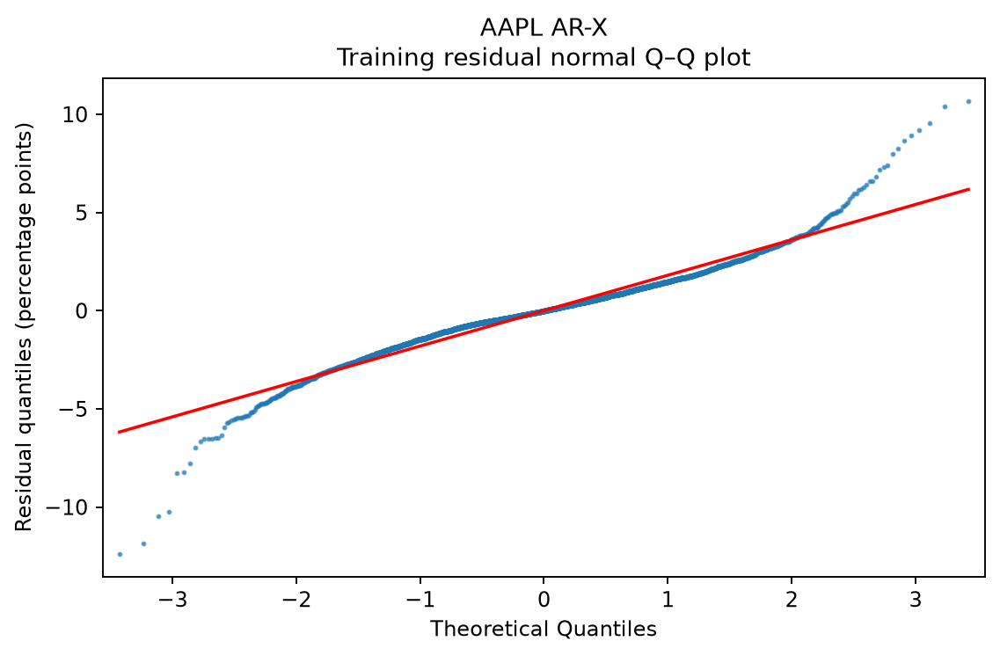
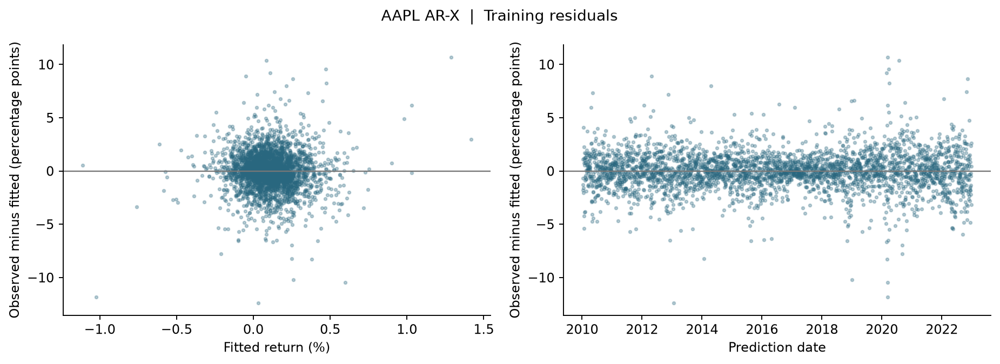

# Milestone 2 basic time series model and diagnostics

This branch adds **1,846,178 complete daily stock observations** from **492 companies during 2010–2025**, alongside the existing **28,496 earnings announcements**. It fits a basic autoregressive model with past-quarter and past-year predictors and supplies Q–Q, residual and autocorrelation plots.

Daily stock-days and earnings announcements are separate observation types. The daily panel is a companion time-series exercise; the event model continues to answer the original question about the five sessions after an earnings reaction. The two row counts must not be added together or described as independent earnings events.

## Professor feedback implemented

| Requested work | Implementation |
| --- | --- |
| Basic time-series model | Actual statsmodels AutoReg AR-X for AAPL; pooled within-company lag regressions for the large daily panel |
| Past quarters and years as predictors | Last completed calendar-quarter return, same calendar quarter last year, and last completed calendar-year return |
| Fit regression and basic diagnostics | Training-only fits, chronological evaluation, coefficient tables, Q–Q and residual plots, ACF and residual tests |
| Larger scale data | 1,846,178 daily observations, labeled separately from the earnings-event dataset |

## Data and temporal definitions

Cached Yahoo adjusted-price histories supplied 1,877,686 candidate stock-days. Required historical predictors and return targets leave 1,846,178 complete stock-days. Rows lacking required historical values are excluded and documented in company coverage. The 2010–2025 observation period uses 2008–2009 only as warm-up history.

Each daily row represents a prediction at that stock session's close. `return_lag1` is the return just observed, `return_lag2` the preceding session's return and `return_lag5` the return four sessions earlier. These correspond to lags 1, 2 and 5 of the next-session response. Market return at the current close is also known. Calendar predictors use completed periods, not a rolling approximation of 63 or 252 days.

For a prediction in 2020 Q2, the calendar predictors use 2020 Q1, 2019 Q2 and calendar year 2019. The source end dates are stored. The current unfinished quarter/year is never used. A period must have a valid stock close on the market's final observed session.

The primary daily target is the next-session return. Five-session forward returns are also stored to connect with earnings events, but the two horizons are not mixed when scoring. Separate split fields purge labels crossing the next training/validation/test boundary.

The existing 28,496-event table is preserved. Its new calendar/event-lag table has 28,368 rows with all required time-series inputs. The two autoregressive inputs are the latest completed earnings-event return and the fourth latest completed return. A past event is usable only after its five-session outcome window has ended. Four prior events do not necessarily equal one fiscal year when announcements are missing; the separate calendar features provide the explicit quarter/year history.

## Model definitions

**Daily pooled AR-X:** next-session stock return is regressed on its three within-company return lags, three completed-calendar return predictors, and the known market return. Coefficients are shared across companies. Lags are constructed separately for each company, so one company's final row never becomes another company's first lag. Mean and zero forecasts and a three-lag AR regression provide basic references.

**AAPL AutoReg AR-X:** an actual single-series `statsmodels.tsa.ar_model.AutoReg` fit with lags `[1, 2, 5]` and the four known exogenous inputs. AAPL was fixed as the illustrative company before results, not selected for its performance. Conditional estimation drops five initial training observations. Evaluation is rolling one-step prediction using already-realized past returns, with fixed coefficients fitted through 2022. [AutoReg documentation](https://www.statsmodels.org/stable/generated/statsmodels.tsa.ar_model.AutoReg.html).

**Earnings-event AR-X:** five-session return after reaction close is regressed on two completed-event return lags, the three calendar-history inputs, current earnings surprise and reaction-day return. It is a dynamic panel regression on irregular earnings events, not a claim that earnings dates form an equally spaced daily series.

Lags are fixed from the professor's requested basic model; no validation/test-driven search or outlier deletion occurs. Scaling is fitted on training only. Pooled coefficient uncertainty uses two-way clustering by company and prediction date; the AAPL example uses HAC standard errors with five lags. These are approximate covariance adjustments, not proof that all dependence is resolved.

## Chronological evaluation

All coefficients use 2010–2022 training observations. Validation is 2023–2024 and the already-inspected 2025 period remains exploratory. Labels crossing a boundary are purged separately for the one-day and five-day horizons. Later lagged returns may update as they actually become observable; future returns are never used early and coefficients are not refitted on later periods.

**Daily pooled next-session results.** MAE/RMSE are return percentage points, with lower values preferred.

| Period | Model | Observations | MAE pp | RMSE pp |
| --- | --- | --- | --- | --- |
| validation | Training mean | 244,990 | 1.2591 | 1.9187 |
| validation | Zero | 244,990 | 1.2610 | 1.9204 |
| validation | Pooled AR lags 1 2 5 | 244,990 | 1.2604 | 1.9207 |
| validation | Pooled ARX with quarter year | 244,990 | 1.2630 | 1.9232 |
| exploratory_test | Training mean | 122,507 | 1.4430 | 2.2682 |
| exploratory_test | Zero | 122,507 | 1.4448 | 2.2692 |
| exploratory_test | Pooled AR lags 1 2 5 | 122,507 | 1.4416 | 2.2660 |
| exploratory_test | Pooled ARX with quarter year | 122,507 | 1.4403 | 2.2644 |

**AAPL next-session AutoReg results.** These use only AAPL, so they are not directly comparable to the pooled panel's cross-company sample.

| Period | Model | Observations | MAE pp | RMSE pp |
| --- | --- | --- | --- | --- |
| validation | Training mean | 501 | 1.0000 | 1.3445 |
| validation | Zero | 501 | 1.0092 | 1.3522 |
| validation | AAPL AutoReg ARX | 501 | 1.0071 | 1.3524 |
| exploratory_test | Training mean | 249 | 1.2720 | 2.0414 |
| exploratory_test | Zero | 249 | 1.2740 | 2.0420 |
| exploratory_test | AAPL AutoReg ARX | 249 | 1.2789 | 2.0388 |

**Earnings-event five-session results.** All compared event models use the same complete lag table and horizon.

| Period | Model | Observations | MAE pp | RMSE pp |
| --- | --- | --- | --- | --- |
| validation | Training mean | 3,869 | 2.9905 | 4.2346 |
| validation | Zero | 3,869 | 3.0023 | 4.2611 |
| validation | Event autoregression | 3,869 | 2.9908 | 4.2341 |
| validation | Event ARX quarter year | 3,869 | 3.0140 | 4.2655 |
| exploratory_test | Training mean | 1,947 | 3.3039 | 4.6373 |
| exploratory_test | Zero | 1,947 | 3.3235 | 4.6567 |
| exploratory_test | Event autoregression | 1,947 | 3.3137 | 4.6553 |
| exploratory_test | Event ARX quarter year | 1,947 | 3.2903 | 4.6035 |

The row counts and horizons differ across these three analyses. Compare models within a table, not the absolute RMSE of daily returns with five-session returns.

The pooled daily AR-X has slightly lower error than the mean in 2025 but higher error in validation. The event AR-X likewise improves 2025 RMSE but performs worse in validation. The added temporal predictors therefore do not yet show consistent gains across both periods.

## Required Q Q and residual plots

[AAPL normal Q–Q plot](../outputs/milestone2_timeseries/aapl_autoreg_qq.png) compares training residual quantiles with a normal distribution. A straight pattern supports approximate normality; tail departures indicate unusually large errors or skewness. [Q–Q documentation](https://www.statsmodels.org/stable/generated/statsmodels.graphics.gofplots.qqplot.html).



[AAPL residual plots](../outputs/milestone2_timeseries/aapl_autoreg_residuals.png) show observed minus fitted return versus fitted return and date. A well-behaved pattern would stay around zero without systematic shape or changing spread. Large spikes and changing spread suggest remaining model limitations.



[AAPL residual ACF](../outputs/milestone2_timeseries/aapl_autoreg_acf.png) uses consecutive observations of one stock. It is not calculated by concatenating different companies, which would create false time adjacency.

The earnings-event model also has its own [Q–Q plot](../outputs/milestone2_timeseries/event_arx_qq.png) and [residual plots](../outputs/milestone2_timeseries/event_arx_residuals.png). Its pooled Q–Q is a descriptive marginal distribution; irregular company-event rows are not treated as one regular time series for autocorrelation tests.

## Basic diagnostic results

| AAPL training diagnostic | Actual value |
| --- | --- |
| Training residual count | 3266 |
| Skewness | -0.0992 |
| Kurtosis normal reference 3 | 7.6786 |
| Jarque Bera normality p | 0 |
| Durbin Watson | 1.9951 |
| Breusch Pagan heteroskedasticity p | 3.815e-18 |
| ARCH dependence in squared residuals p | 6.283e-51 |

| Ljung Box lag | Statistic | Approximate p value |
| --- | --- | --- |
| 5 | 3.3832 | 0.1842 |
| 10 | 39.5330 | 1.546e-06 |
| 20 | 59.9887 | 1.055e-06 |

The actual AAPL Q–Q plot has tails that depart substantially from the normal reference line; its kurtosis is about 7.68, compared with 3 under normality. The variance tests flag nonconstant variance, and Ljung–Box at lags 10 and 20 flags residual dependence. Durbin–Watson near 2 does not rule out that longer-lag dependence. HAC standard errors address part of the inference problem; they do not remove the residual pattern or improve forecasts by themselves.

Small normality or variance-test p-values flag departures from those assumptions; they do not establish useful forecasts. Financial-return tails, changing variance and serial dependence can remain after a basic AR-X fit. Ljung–Box uses three fitted AR terms for its degrees-of-freedom adjustment. Diagnostics assess the fitted model assumptions. [Ljung–Box documentation](https://www.statsmodels.org/stable/generated/statsmodels.stats.diagnostic.acorr_ljungbox.html).

## Verification and remaining limits

Every stored daily target and lag was checked against source prices across 1,846,178 rows, and completed-event lags were checked for 28,368 model-complete events. The recorded checks have 0 errors. Predictors use float32 storage for compactness; return targets remain float64. Verification tolerances account explicitly for predictor rounding; source dates and split rules are checked exactly.

Twenty automated tests cover the existing pipelines plus completed-calendar lags, truncated-cache periods, missing-year history, future-price invariance, completed-event availability and horizon-specific purging. The current constituent roster still has survivorship bias, exact earnings-release times and vendor vintages remain unresolved, and millions of repeated stock-days are not millions of independent observations.

## Run and inspect

```powershell
.\.venv\Scripts\python.exe -m pip install -r requirements-timeseries.txt
.\.venv\Scripts\python.exe run_milestone2_timeseries.py --fit-only
```

The full derived daily dataset is committed as sixteen compressed yearly Parquet files under `research/datasets/timeseries_daily/`. The event lag table is `research/datasets/timeseries_events.csv`. Rebuilding from cached source prices uses `run_milestone2_timeseries.py --build-only`; the default command rebuilds and fits. Fit-only uses the committed data and makes no API calls.
