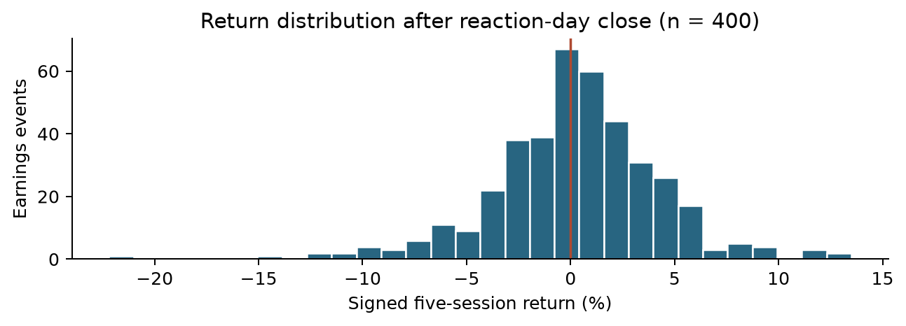
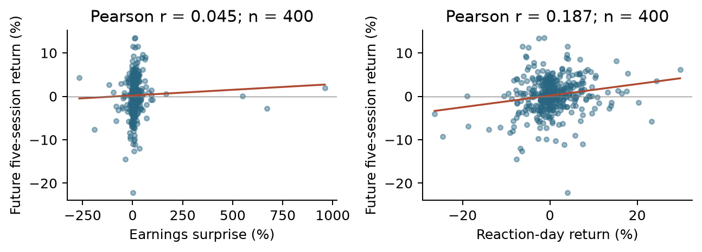

# Milestone 2 Meeting 1 Preparation

Data pipeline and initial exploratory evidence
Georgia Tech ISYE 4031 Fall 2026 Group 9
Bill Nguyen, Sarah Wang, Cindy Le, Phoenix Moore, Victor Wang
Prepared October 21 2026

Meeting purpose. We will present the usable dataset, explain the prediction timing and data-quality concerns, and agree on the baseline and evaluation plan. The pilot contains 400 complete earnings events. Initial relationships are weak, so the main question is whether a regression can improve on a simple constant forecast in later periods.

Meeting details. Thursday, October 22, 2026, during 2:00-3:00 p.m. Eastern at George Tower 802 Collab. Group 9 should plan for approximately eight minutes. This packet covers the data and exploratory work for Meeting 1; the baseline results and residual diagnostics are in the full Milestone 2 report.

## Research question and intended decision

After the initial market reaction to quarterly earnings, can earnings, price, volume, momentum and volatility information predict the direction and magnitude of a stock's return over the following five trading sessions? Investors could use a successful model to inform buy, hold, sell or avoid decisions. We keep negative outcomes in the regression and do not restrict the sample to events that later rise.

## Prediction target and timing

The reaction day is the first available stock trading day strictly after the reported earnings date. We predict at that day's close. If its index is i, the outcome is P[i+5]/P[i]-1, covering sessions i+1 through i+5. Adjusted closes are used for all symbols in this snapshot. The initial reaction-day price change is a predictor and is excluded from the target. A secondary target subtracts SPY's return over the same calendar dates.

## Data sources and pipeline

One observation is one company's quarterly earnings event. Alpha Vantage EARNINGS supplies dates, EPS estimates, reported EPS and surprises. Yahoo Finance through yfinance supplies daily prices and volume for AAPL, AMZN, GOOGL, JNJ, JPM, META, MSFT, NVDA, WMT, XOM and benchmark SPY. Earnings dates span January 14, 2016-November 20, 2025. Each company contributes 40 events. Prices cover November 2, 2015-January 30, 2026. The analysis reuses existing caches; no new or paid access is required for this local snapshot.

| Pipeline stage | Observed count |
| --- | --- |
| Parse cached quarterly earnings | 1,105 source records |
| Restrict reported dates to 2016-2025 | 400 events; 705 outside the window |
| Match to first strictly later stock session | 400 matched; reject gaps over 7 calendar days |
| Build features and stock and SPY targets | 400 complete events; no missingness exclusions |

## Predictors available at prediction time

Candidate predictors are current and previous-quarter earnings surprise (%), reported and estimated EPS (USD/share), reaction-day return, prior 5- and 20-session stock returns, prior 20-return sample volatility, prior 5-session SPY return and abnormal volume. Abnormal volume divides reaction-day volume by mean volume over the prior 20 sessions. All historical windows end before reaction day; reaction-day information is available by its close. Dollar EPS surprise remains in the dataset but is redundant with reported minus estimated EPS and is omitted from the regression.

## Initial exploratory evidence

Figure 1. Signed five-session stock returns after reaction-day close. The vertical line marks zero; all 400 events remain.

Of 400 events, 223 (55.75%) have positive returns and 177 (44.25%) have negative returns; none are zero. Mean return is +0.242%, median +0.319%, and standard deviation 4.085 percentage points. Returns range from -22.196% to +13.496%. Variation is large relative to the mean, so evaluating a naive comparator and large forecast errors is important.

Figure 2. Earnings surprise and reaction-day return versus later signed return. Both panels retain all 400 events; lines summarize full-sample relationships.

Earnings surprise has little linear association with future return (r = 0.045). Reaction-day return has a modest positive association (r = 0.187), which is consistent with some continuation but leaves substantial scatter. These patterns motivate a simple baseline; they do not establish forecasting skill or a causal effect.

## Data quality and unusual values

There are zero missing values in the 11 candidate predictors and both return targets, zero duplicate event keys and zero invalid timing rows. Cached price series have no duplicate or invalid dates, missing close or volume fields, nonpositive closes or negative volumes. Independent reconstruction of all 400 events' dates, predictors and targets agrees within 10^-12. These checks establish internal consistency rather than historical completeness or vendor accuracy.

Seven events have absolute earnings surprise above 100%. XOM's May 1, 2020 event has a 960% surprise with estimated EPS of $0.05. We retain these source values; small denominators can create very large percentages. Later diagnostics should examine influence rather than automatically remove extreme events.

## Dependence and leakage concerns

Each company has 40 repeated events. There are 597 overlapping future-window pairs across companies, and 148 events share a reaction date. Common market shocks can correlate errors; 400 rows are not 400 independent experiments. The ten currently active large companies also create a narrow sample with survivorship risk.

Date-only earnings records do not consistently distinguish before-market from after-market releases. The first-later-session rule separates the target mechanically, but it may not capture the actual initial reaction equally for every release. Retrospective EPS estimates and adjusted prices may also contain revisions unavailable at the historical prediction time. Future stock and SPY returns are used only for outcomes, never as predictors.

## Baseline and evaluation plan

Use ordinary least squares with an intercept and the 10 nonredundant predictors. The primary response is raw signed return; SPY-adjusted return is secondary. Fit the scaler and regression using 2016-2022 only (n = 280), validate on 2023-2024 (n = 80), and summarize 2025 as an exploratory test (n = 40). Remove any earlier-period event whose target window crosses the next boundary; no events require removal in this snapshot. Keep time order and do not randomly shuffle.

Compare regression forecasts with the training-mean and zero forecasts using MAE and RMSE in percentage points, with R-squared as supplementary context. Inspect residuals and influential observations. Later evaluation should use rolling chronological origins and account for company and calendar dependence. The existing baseline has already been run, so 2025 cannot be treated as a new untouched test after future model changes.

## Proposed work ownership

| Member | Proposed focus before the next meeting |
| --- | --- |
| Bill Nguyen | Review plots and error summaries by year and company |
| Sarah Wang | Review missingness, unusual values and feature definitions |
| Cindy Le | Check release timing and historical availability of data |
| Phoenix Moore | Refine application, limitations and report text |
| Victor Wang | Verify code, baseline outputs and reproducibility package |

## Questions for the TA

1. Is the first trading day after a date-only report an acceptable reaction-day convention, or must release times be sourced?

1. Should raw signed return remain the primary target, with SPY-adjusted return as a secondary analysis?

1. Is the 400-event pilot sufficient for this milestone, and what historical selection rule should guide expansion?

1. How should rolling evaluation and uncertainty account for overlapping market windows and repeated companies?

1. Can positive signed predictions support the application without filtering out negative realized outcomes?

## Code and materials to bring

Bring this packet, the working project and the data-access README. Run python run_pipeline.py, then python run_milestone2.py from the project root to rebuild the analysis. The notebook notebooks/02_milestone2_analysis.ipynb exposes the outputs. Sources: Alpha Vantage EARNINGS documentation, yfinance PriceHistory documentation, and the course Milestone 2 brief. OpenAI Codex assisted with code, analysis and document preparation; the group should verify the results and follow syllabus disclosure rules.
